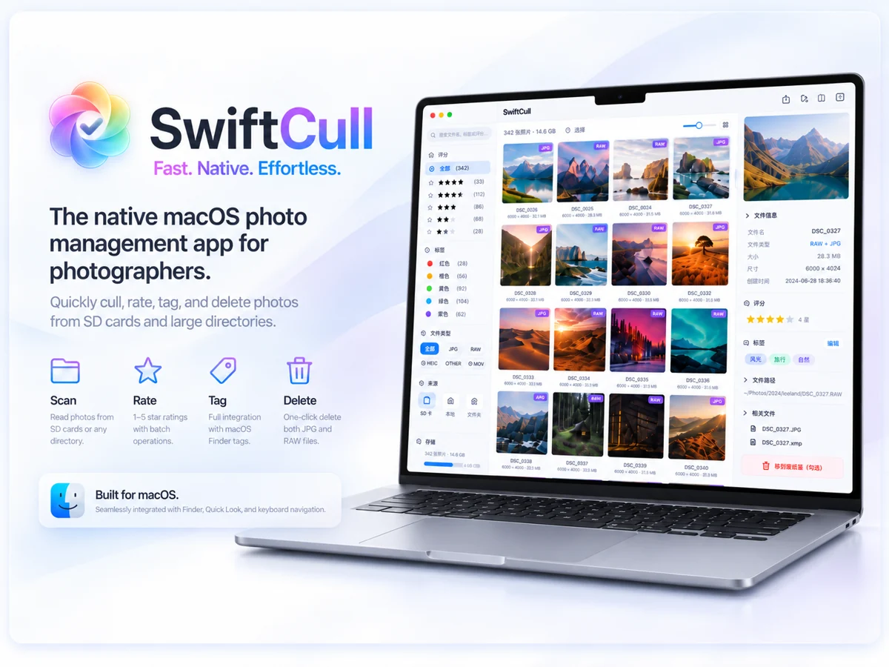
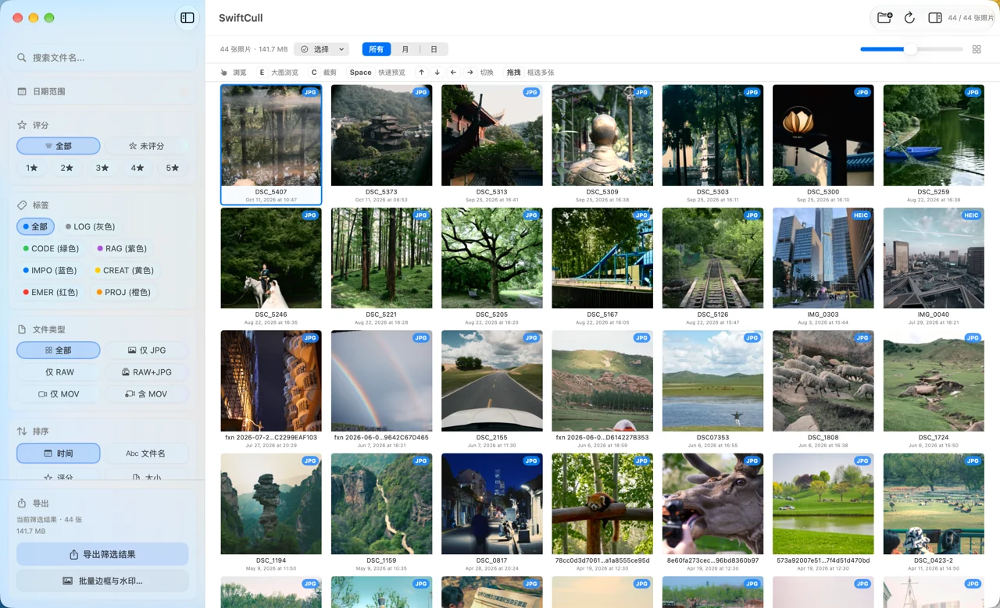
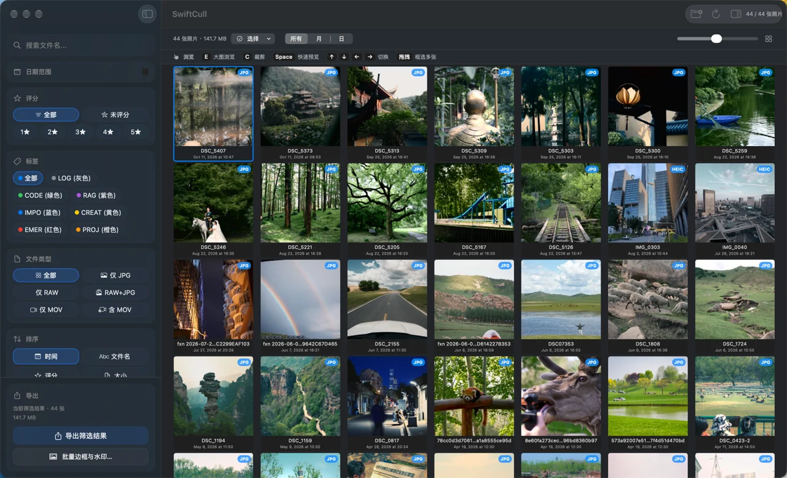
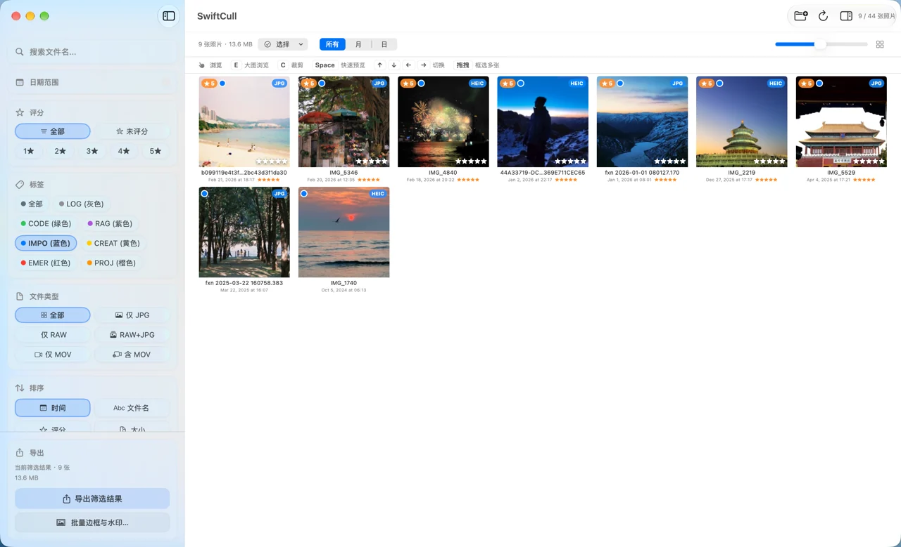
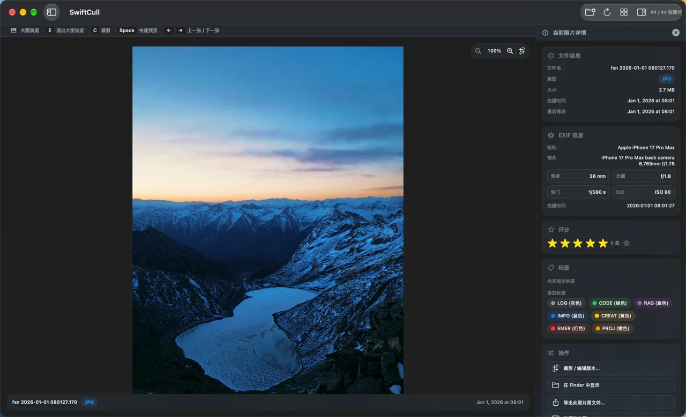
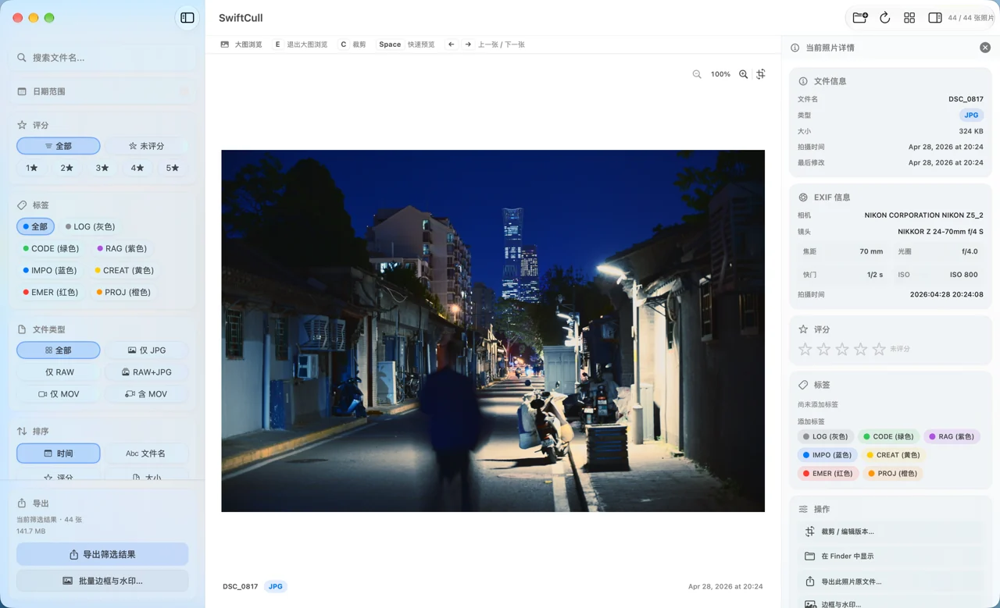
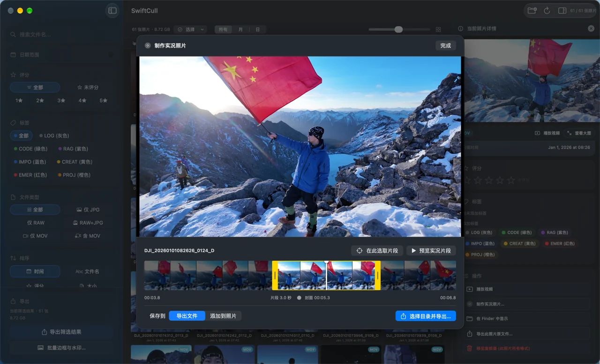
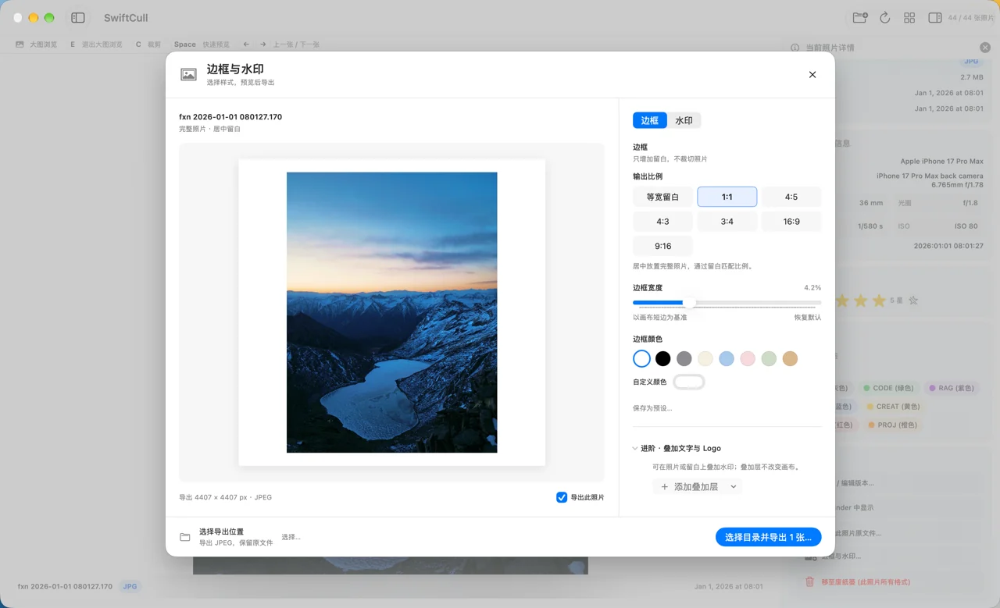
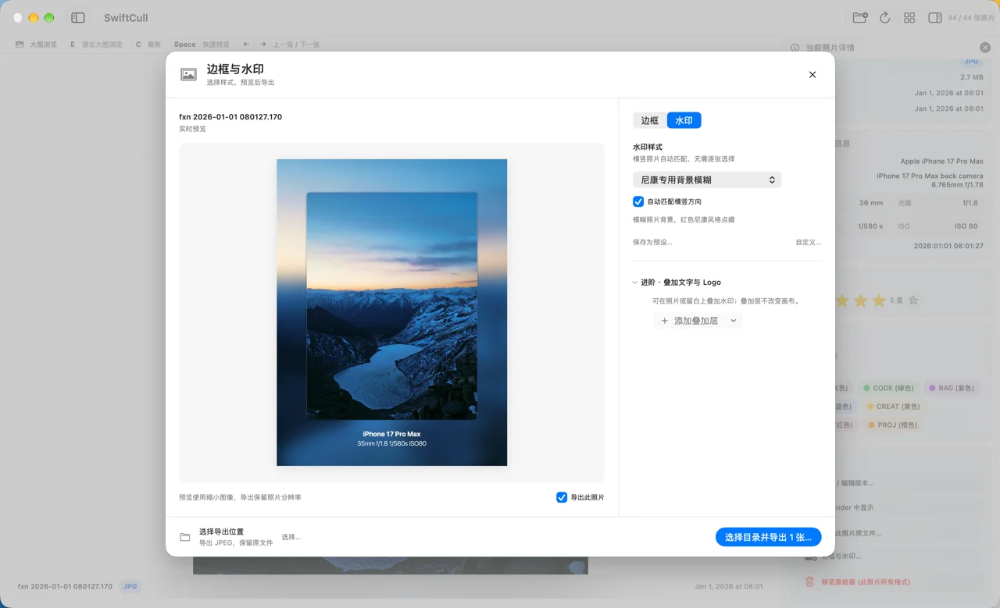
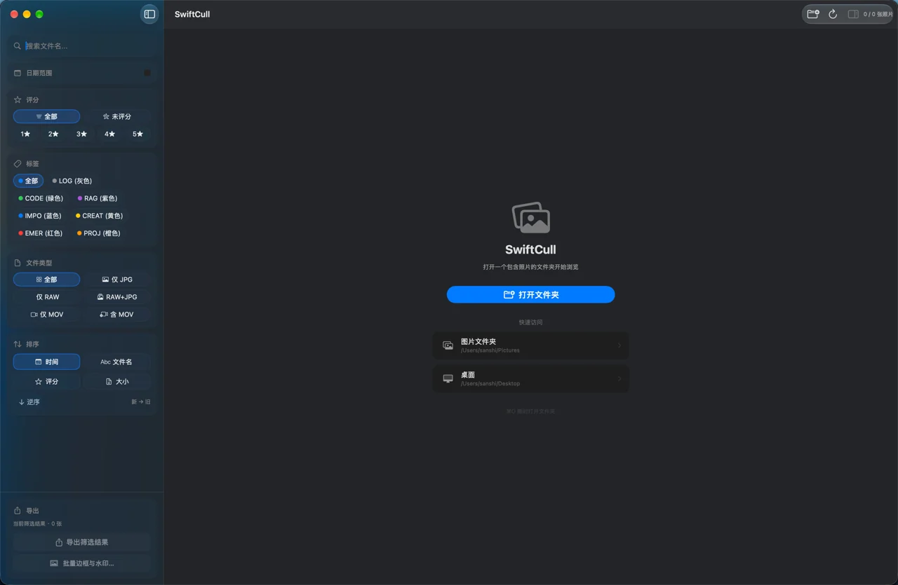

<div align="center">

<h1>SwiftCull</h1>

**轻量、简洁的 macOS 原生照片筛选工具。**

浏览、标记、筛选、导出，让选片更专注。

<p align="center">
  <a href="https://github.com/SAN-SHIa/SwiftCull/releases/latest"></a>
  
  <a href="https://github.com/SAN-SHIa/SwiftCull/actions/workflows/build.yml"></a>
  <a href="https://github.com/SAN-SHIa/SwiftCull/blob/main/LICENSE"></a>
</p>

**[下载最新版本](https://github.com/SAN-SHIa/SwiftCull/releases/latest) · [版本记录](https://github.com/SAN-SHIa/SwiftCull/releases) · [问题反馈](https://github.com/SAN-SHIa/SwiftCull/issues)**

[快速上手](#快速上手) · [主要功能](#主要功能) · [功能展示](#功能展示) · [快捷键与手势](#快捷键与手势) · [开发指南](#开发指南)

<a href="./assets/pics/post.png"></a>

</div>

---

## 下载与安装

**系统要求：macOS 14.0（Sonoma）或更高版本。**

前往 [Releases](https://github.com/SAN-SHIa/SwiftCull/releases/latest) 下载 `SwiftCull.dmg`，打开后将 SwiftCull 拖入“应用程序”文件夹。

<details>
<summary>macOS 提示无法打开应用？</summary>

未经 Apple 公证的构建可能被 macOS 安全检查拦截。确认文件来自本仓库的 Releases 页面后，可前往“系统设置 → 隐私与安全性”查看相关提示。

</details>

## 快速上手

1. **打开照片文件夹** — 从桌面或 Finder 将一个文件夹拖入应用窗口，或按 `⌘O` 选择目录；按 `E` 切换大图，或按空格使用 Quick Look 预览。
2. **标记需要的照片** — 按 `1`–`5` 评分，按 `0` 清除评分，也可使用 Finder 标签。拖拽框选可批量标注，完成后点击“完成”或按 `Q` 保存。
3. **筛选并导出** — 按评分、标签、文件类型等缩小范围，再复制或导出所选照片；需要时添加裁剪或水印。

> **批量标注需确认保存。** 在多选模式中，`Esc` 会取消尚未提交的批量标注。`⌘B` / `⌘⇧B` 可分别收起左栏 / 右栏，留出更多看图空间。

## 主要功能

| 功能 | 说明 |
| --- | --- |
| 浏览与筛选 | 按文件类型、评分、Finder 标签、文件名及拍摄日期筛选；支持按月或按日分组，以及最高 6 倍的大图缩放。 |
| 评分与标签 | 评分按照片目录保存，Finder 标签同步至关联文件；支持批量标注、确认保存和取消修改。 |
| 多选与文件操作 | 提供右键菜单、框选、复制、导出及移至废纸篓操作；关联同目录下同名的照片与视频文件。 |
| 裁剪与版本 | 支持自由、原始比例、1:1、3:2、4:3 和 16:9 裁剪，可更新当前版本或创建虚拟副本；预览、复制与导出使用所选版本。 |
| 边框与水印 | 支持等宽留白及 6 种画布比例，可调节边框宽度与颜色；保留 15 种水印预设、文字和 Logo 组件，支持保存预设、逐张调整及批量导出。 |
| 视频与实况照片 | 支持视频播放、跳转、逐帧查看及音量控制；可选取 0.5–3 秒片段和封面，导出 HEIC + MOV，或添加到系统“照片”。 |

---

## 功能展示

从浏览、筛选到导出，常用操作集中在同一窗口。点击截图可查看原图。

### 浏览与外观

左侧筛选、中央网格、右侧照片详情，可按需要收起两侧面板。支持浅色与深色外观。

<table>
  <tr>
    <td align="center" width="50%">
      <a href="./assets/pics/light.png"></a><br />
      <b>浅色模式</b><br />
      <sub>在网格中浏览照片，按月或按日分组。</sub>
    </td>
    <td align="center" width="50%">
      <a href="./assets/pics/dark.png"></a><br />
      <b>深色模式</b><br />
      <sub>保留相同布局与操作，适应不同查看环境。</sub>
    </td>
  </tr>
</table>

### 筛选与标记

先按文件名、日期、评分、标签或文件类型缩小范围，再逐张查看照片与拍摄信息。

<table>
  <tr>
    <td align="center" width="50%">
      <a href="./assets/pics/filter.png"></a><br />
      <b>组合筛选</b><br />
      <sub>在左栏组合筛选条件，按当前结果导出。</sub>
    </td>
    <td align="center" width="50%">
      <a href="./assets/pics/tag.png"></a><br />
      <b>评分与标签</b><br />
      <sub>支持单张标记与框选批量标注，Finder 标签同步至关联文件。</sub>
    </td>
  </tr>
</table>

### 大图与实况照片

按 `E` 切换大图，结合 EXIF 信息查看细节；有配对视频的照片可继续制作实况照片。

<table>
  <tr>
    <td align="center" width="50%">
      <a href="./assets/pics/photo-info.png"></a><br />
      <b>大图与拍摄信息</b><br />
      <sub>查看文件信息、相机、镜头、焦距、光圈、快门与 ISO。</sub>
    </td>
    <td align="center" width="50%">
      <a href="./assets/pics/video-live.png"></a><br />
      <b>视频与实况照片</b><br />
      <sub>选取 0.5–3 秒视频片段与封面，导出 HEIC + MOV 或添加到系统“照片”。</sub>
    </td>
  </tr>
</table>

### 边框与水印

从照片右键菜单或左栏的“批量边框与水印…”进入。调整当前照片、检查预览，再选择导出位置。

<table>
  <tr>
    <td align="center" width="50%">
      <a href="./assets/pics/frame.png"></a><br />
      <b>居中边框</b><br />
      <sub>等宽留白与 6 种画布比例；调节宽度、颜色，完整保留照片。</sub>
    </td>
    <td align="center" width="50%">
      <a href="./assets/pics/watermark.png"></a><br />
      <b>水印预设</b><br />
      <sub>15 种横竖版模板，可叠加文字与 Logo，并保存常用预设。</sub>
    </td>
  </tr>
</table>

底部照片条可切换当前照片及勾选导出范围。**调整默认只作用于当前照片**；点击“将当前样式应用到已勾选的 N 张”可统一样式。未勾选照片不会被修改，导出 JPEG 时保留原文件。

<details>
<summary><b>打开文件夹与快速访问</b></summary>

从桌面或 Finder 将一个照片文件夹拖入窗口，或按 `⌘O` 选择目录。欢迎页也提供检测到的存储位置，便于快速访问。

<p align="center">
  <a href="./assets/pics/welcom-page.png"></a>
</p>

</details>

---

## 文件与版本

### 文件格式

| 类型 | 当前扫描支持 |
| --- | --- |
| 常规图像 | JPEG、HEIC、HEIF、TIFF |
| RAW | NEF、CR2、ARW、DNG、RAF |
| 视频 | MOV、MP4、AVI |

RAW 解码和视频播放取决于 macOS 对相应相机格式及编码的支持。PNG、CR3 等格式尚未纳入当前扫描范围。

<details>
<summary><b>文件与版本如何保存？</b></summary>

| 操作 | 保存方式 |
| --- | --- |
| 评分与标签 | 评分按照片目录保存；Finder 标签写入关联文件的元数据。 |
| 裁剪 | 不修改原始图像内容，可更新当前版本或创建虚拟副本；预览、复制与导出使用所选版本。 |
| 复制与导出 | 未裁剪时按所选范围复制原文件；裁剪后的 RAW 文件以 TIFF 输出，边框与水印照片以 JPEG 输出。 |
| 移至废纸篓 | 确认后处理所选范围内的关联文件，保留裁剪记录；将原文件恢复到原目录并保持原文件名后，刷新即可重新加载裁剪版本。 |

视频及关联视频的照片不参与裁剪。

</details>

---

## 快捷键与手势

| 常用操作 | 快捷键 |
| --- | --- |
| 打开文件夹 | `⌘O` |
| 切换网格 / 大图 | `E` |
| 快速预览 | `Space` |
| 设置 / 清除评分 | `1`–`5` / `0` |
| 显示或隐藏左栏 / 右栏 | `⌘B` / `⌘⇧B` |

<details>
<summary><b>全部照片快捷键与手势</b></summary>

| 操作 | 说明 |
| --- | --- |
| `⌘O` | 打开文件夹 |
| 方向键 | 按网格位置切换当前照片 |
| `E` | 切换网格与大图视图 |
| `Space` | 使用 Quick Look 预览 |
| `C` | 裁剪当前单张照片或编辑所选版本 |
| `1`–`5` / `0` | 设置评分 / 清除评分 |
| `A` 或 `⌘A` | 全选当前筛选结果 |
| `Q` / `Esc` | 确认多选模式中的批量标注 / 取消未提交的批量标注并退出多选；输入框聚焦时，`Esc` 取消输入焦点 |
| `⌘C` | 复制所选版本，可在 Finder 中粘贴；裁剪版本会先生成对应文件 |
| `Delete` | 请求将所选照片的关联文件移至废纸篓，确认后执行 |
| `⌘B` 或 `Tab` | 显示或隐藏左栏 |
| `⌘⇧B` | 显示或隐藏右栏 |

鼠标拖拽可框选多张照片，双指捏合可调整网格缩略图大小。大图视图支持捏合、双击或使用 `＋` / `－` 缩放，并可拖拽平移。

</details>

<details>
<summary><b>视频与实况照片快捷键</b></summary>

以下视频快捷键在视频播放模式下生效；实况照片预览快捷键仅在对应编辑器中生效。

| 操作 | 说明 |
| --- | --- |
| `V` | 进入或退出当前关联视频的播放模式 |
| `Space` | 播放或暂停视频 |
| `←` / `→` | 后退或前进 5 秒 |
| `Shift` + `←` / `→` | 逐帧查看 |
| `↑` / `↓` | 调高或调低音量 |
| `Esc` | 退出视频播放模式 |
| `P` | 在实况照片编辑器中预览或停止所选片段，结束后返回预览前的位置 |

</details>

---

## 开发指南

SwiftCull 基于 **SwiftUI 与 macOS 系统框架**构建。源码构建需要完整安装的 **Xcode** 和 [XcodeGen](https://github.com/yonaskolb/XcodeGen)；已在 Xcode 26.2 下完成构建验证。

<details>
<summary><b>从源码构建与运行</b></summary>

使用 [Homebrew](https://brew.sh/) 安装 XcodeGen 后，生成工程并启动应用：

```bash
git clone https://github.com/SAN-SHIa/SwiftCull.git
cd SwiftCull
brew install xcodegen
xcodegen generate
bash run.sh run
```

也可执行 `open SwiftCull.xcodeproj`，在 Xcode 中构建与调试。

| 命令 | 用途 |
| --- | --- |
| `bash run.sh build` | 构建 Debug 版本 |
| `bash run.sh release` | 构建 Release 版本 |
| `bash run.sh dmg` | 构建并打包 DMG |
| `bash run.sh gen` | 根据 `project.yml` 重新生成 Xcode 工程 |
| `bash run.sh clean` | 清理构建产物 |
| `bash run.sh help` | 查看脚本用法 |

增删源文件或修改 `project.yml` 后，请重新生成 Xcode 工程。

</details>

<details>
<summary><b>运行冒烟测试</b></summary>

构建通过后，可运行以下冒烟测试。实况照片测试需要 `ffmpeg`（`brew install ffmpeg`）；数据完整性测试使用临时文件和隔离存储。

```bash
bash Tests/run-watermark-smoke.sh
bash Tests/run-photo-action-scope-smoke.sh
bash Tests/run-crop-smoke.sh
bash Tests/run-thumbnail-pipeline-smoke.sh
bash Tests/run-grid-interaction-smoke.sh
bash Tests/run-live-photo-smoke.sh
bash Tests/run-data-integrity-smoke.sh
```

网格交互测试需要已登录的 macOS 桌面，会短暂打开测试窗口，自动验证方向键导航和框选。

</details>

## 后续规划

- **扩展格式支持**：优先考虑 PNG，再逐步验证 CR3、RW2、HIF、NRW、ORF、PEF 等格式的扫描、解码与导出。
- **目录导航**：评估应用内前进、后退及文件夹导航；需先明确目录切换与标注、筛选状态的关系，目前尚未排期。

## 反馈与贡献

开发前请阅读 [协作规范](AGENTS.md)。[.agent/](.agent/README.md) 与 [.claude/](.claude/CLAUDE.md) 提供工具入口，统一引用同一份规范。

首次克隆后运行 `bash .agent/setup-git-hooks.sh` 启用本地提交信息格式校验。

欢迎通过 [Issues](https://github.com/SAN-SHIa/SwiftCull/issues) 反馈问题或提出建议，也欢迎提交 Pull Request。反馈问题时，请附上 macOS 版本、应用版本、文件格式和复现步骤；界面问题可附截图。

## 许可证

SwiftCull 的项目代码以 [MIT License](LICENSE) 开源。第三方字体、素材与改编代码适用各自的许可证，来源及许可全文见[第三方声明](THIRD_PARTY_NOTICES.md)。
