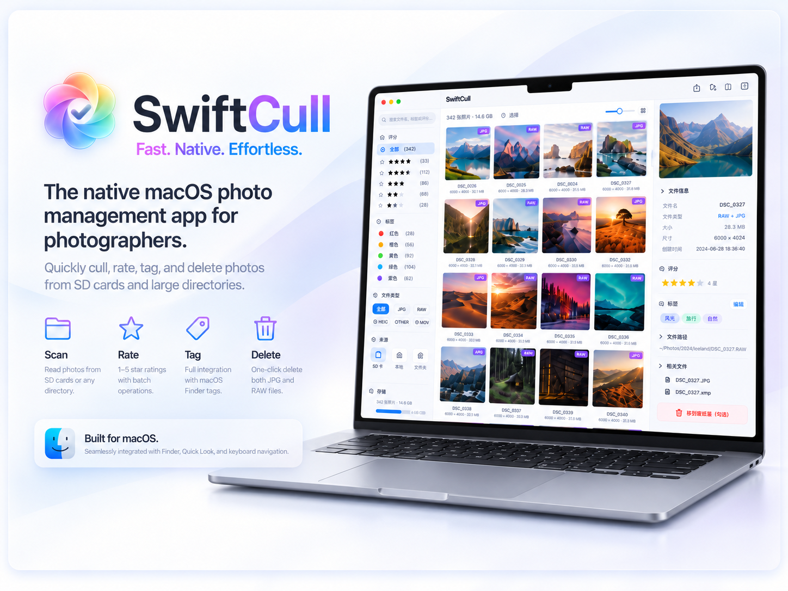

# ⚡ SwiftCull - 照片快筛

<div align="center">
  <div>
    <a href="https://github.com/ChenApr/SwiftCull/releases"></a>
    <a href="https://github.com/ChenApr/SwiftCull"></a>
    <a href="https://github.com/ChenApr/SwiftCull/blob/main/LICENSE"></a>
    <a href="https://github.com/ChenApr/SwiftCull"></a>
    <a href="https://github.com/ChenApr/SwiftCull"></a>
  </div>
  <br>
</div>

<p align="center">
  
</p>

> 一款为摄影师打造的 macOS 原生照片快速筛选工具。从 SD 卡里的数千张照片中，用最少的操作挑出该留的、删掉该删的。纯 SwiftUI + 系统原生框架，无第三方依赖。

---

## 📥 下载安装

前往 [Releases](https://github.com/ChenApr/SwiftCull/releases) 页面下载最新版 `SwiftCull.dmg`，打开后将 SwiftCull 拖入 Applications 即可完成安装。

> [!IMPORTANT]
> 由于应用未经过 Apple 公证（Notarization），macOS 可能会阻止打开。请前往「系统设置 → 隐私与安全性」，点击「仍要打开」即可。

---

## 🎯 功能特性

- 🚀 **多维筛选** — 文件类型、评分、Finder 标签、文件名、拍摄日期，支持按月/日分组浏览
- 🔍 **大图审片** — 单图模式下捏合/双击/按钮缩放（最高 6×），放大后拖拽平移，切图自动复位
- 🏷️ **原生标签与评分** — 读取 Finder 标签并双向同步，批量编辑后「完成」才写入、「取消」即还原
- 🗑️ **配对删除与导出** — 自动关联 RAW+JPG+MOV，删除同步移入废纸篓
- 🖱️ **右键与多选操作** — 评分、Finder 标签、复制原文件、Finder 显示、批量导出和水印导出
- ✂️ **非破坏性裁剪** — 支持自由、原始及常用固定比例，保存到当前版本或另存虚拟版本；预览、复制和导出使用所选版本

---

## 🧭 后续目标

1. **（P1）视频播放**：在应用内直接播放视频。
2. **（P1）从视频截取实况照片**：支持从视频中截取并保存实况照片。
3. **（P2）自定义文字字体**：水印自定义文字支持更多美观字体。
4. **（P2）水印配置叠加**：允许同时应用多个水印配置，例如将照片内签名与带 EXIF 信息的照片边框叠加。
5. **（待确定和设计）Finder 风格导航**：在软件内支持前进、后退和文件夹打开。由于这会影响当前工作区、评分和标签筛选的生效范围，并可能引入较大的破坏性和冗余设计，暂不排期。

---

## 📸 界面预览

<table>
  <tr>
    <td align="center" width="50%">
      <br/>
      <sub><b>深色模式</b></sub>
    </td>
    <td align="center" width="50%">
      <br/>
      <sub><b>浅色模式</b></sub>
    </td>
  </tr>
</table>

---

## 🛠 系统要求

- macOS 14.0 (Sonoma) 或更高版本
- Xcode 16.0 或更高版本（仅源码构建时需要）

---

## 🏗 构建与运行

**方式一：直接下载 DMG（推荐）**

前往 [Releases](https://github.com/ChenApr/SwiftCull/releases) 下载 `SwiftCull.dmg`。

<details>
<summary><strong>方式二：源码构建</strong></summary>

1. 克隆仓库：
   ```bash
   git clone git@github.com:ChenApr/SwiftCull.git
   cd SwiftCull
   ```

2. 生成 Xcode 项目（需要 [XcodeGen](https://github.com/yonaskolb/XcodeGen)）：
   ```bash
   brew install xcodegen
   xcodegen generate
   ```

3. 构建并运行：
   ```bash
   # 使用快捷脚本（推荐）
   ./run.sh           # Debug 构建并启动
   ./run.sh release   # Release 构建
   ./run.sh dmg       # 打包 DMG 安装包
   ./run.sh clean     # 清理构建产物
   ./run.sh help      # 查看所有命令
   ```

   或在 Xcode 中打开：
   ```bash
   open SwiftCull.xcodeproj
   ```

> 修改、增删源文件后，记得重新运行 `xcodegen generate`（或 `./run.sh gen`）同步工程。

</details>

---

## ⌨️ 快捷键指南

<div align="center">

| 快捷键 | 说明 |
|:---|:---|
| `↑` `↓` `←` `→` | 按网格位置选择照片 |
| 拖拽框选 | 鼠标框选多张照片 |
| `Space` | Quick Look 预览 |
| `E` | 网格 / 大图切换 |
| `C` | 裁剪单张照片 / 编辑当前版本（多选时不触发） |
| `Q` | 完成并退出多选 |
| 双指捏合 | 缩放网格缩略图 |
| 大图缩放 | 捏合 / 双击 / `＋` `－` 缩放，拖拽平移 |
| `Tab` | 切换侧边栏 |
| `1`–`5` | 设置评分 |
| `0` | 清除评分 |
| `Delete` | 删除所选照片 |
| `A` | 全选当前筛选结果 |
| `Esc` | 退出多选 / 取消输入焦点 |
| `⌘O` | 打开文件夹 |
| `⌘C` | 复制所选版本；裁剪后的照片可在 Finder 中粘贴 |

</div>

---

## 📄 许可证

SwiftCull 基于 [MIT License](./LICENSE) 开源。

MIT 许可允许你在自己的 fork 中使用、修改、合并、构建、发布和分发 SwiftCull，也允许发布自行修改后的版本。发布源码或包含原项目实质代码的分发包时，请保留原项目的版权声明和 MIT 许可文本；水印素材及其他第三方内容还需要同时遵守 [第三方说明](THIRD_PARTY_NOTICES.md) 中列出的许可。建议在 release 说明中明确列出你的修改，并不要暗示上游项目或其作者为你的版本背书。
